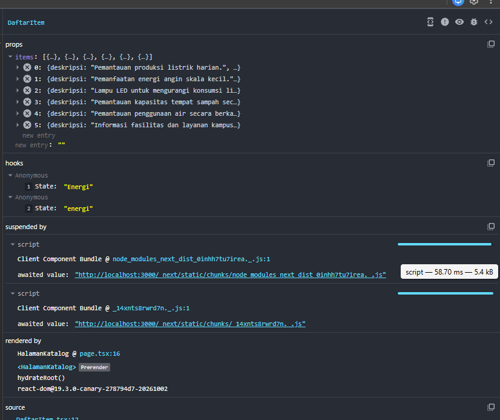
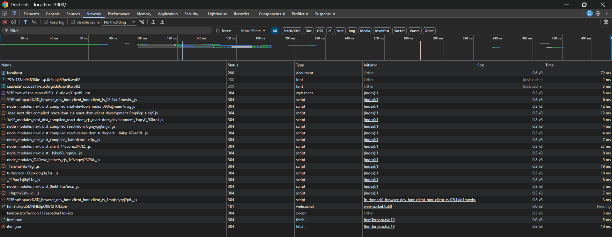
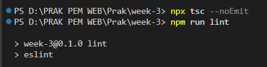

# Dokumen Teknis Modul 3 — TypeScript dan Komponen React

**Nama/NIM:** M. Rizki Ruswan / 105224028 
**Mata kuliah:** Praktikum Pengembangan Aplikasi Web  
**Modul:** Modul 3 — TypeScript dan Komponen React  
**Repositori GitHub:** https://github.com/mrizkiruswan-lab/105224018-Praktikum-Pemweb.git

## 1. Tipe Data

Proyek praktikum pada folder `week-3` menggunakan TypeScript untuk mendefinisikan data yang digunakan pada halaman katalog. Definisi tipe berada pada `lib/tipe.ts`, sedangkan data contoh berada pada `lib/data.ts`.

> **Pemeriksaan sebelum pengumpulan:** pastikan penjelasan dan contoh di bawah sesuai dengan isi aktual `lib/tipe.ts`. Jika nama tipe atau propertinya berbeda, gunakan definisi yang benar-benar terdapat di proyek.

Contoh bentuk tipe data item:

```typescript
export type Kategori = "energi" | "lingkungan" | "kampus";

export interface Item {
  id: number;
  judul: string;
  kategori: Kategori;
  deskripsi: string;
  tersedia: boolean;
  gambar?: string;
}
```

`Kategori` merupakan *union type*. Nilainya dibatasi pada pilihan yang ditentukan sehingga nilai kategori yang tidak sesuai dapat terdeteksi ketika TypeScript memeriksa kode. `Item` merupakan `interface` yang mendefinisikan bentuk objek. Properti `gambar` bersifat opsional karena ditandai dengan `?`.

TypeScript membantu memeriksa kesesuaian tipe saat pengembangan. Namun, definisi tipe tidak otomatis memvalidasi semua data eksternal saat aplikasi berjalan; data dari sumber eksternal tetap perlu ditangani dengan benar.

## 2. Struktur Komponen React

Antarmuka dibagi menjadi beberapa komponen agar setiap bagian mempunyai tanggung jawab yang jelas dan dapat digunakan kembali.

### 2.1 Pohon komponen

```text
RootLayout (app/layout.tsx)
├── SiteHeader
├── Beranda (app/page.tsx)
│   ├── Bagian
│   └── ItemTerbaru
└── SiteFooter

HalamanKatalog (app/katalog/page.tsx)
└── Bagian
    └── DaftarItem
        └── KartuItem
```

Pohon di atas merangkum struktur komponen berdasarkan file proyek yang terlihat. Struktur render aktual dapat memiliki elemen pembungkus tambahan dari Next.js.

### 2.2 Tanggung jawab komponen

| Komponen/file | Tanggung jawab |
|---|---|
| `app/layout.tsx` / `RootLayout` | Menyediakan kerangka umum halaman. |
| `app/page.tsx` / `Beranda` | Menampilkan halaman utama dan bagian-bagian kontennya. |
| `app/katalog/page.tsx` / `HalamanKatalog` | Menampilkan judul katalog dan meneruskan data ke `DaftarItem`. |
| `SiteHeader` | Menampilkan bagian kepala halaman dan navigasi. |
| `SiteFooter` | Menampilkan bagian bawah halaman. |
| `Bagian` | Membungkus konten dengan judul dan struktur yang konsisten. |
| `DaftarItem` | Menampilkan kumpulan item serta interaksi pencarian dan filter. |
| `KartuItem` | Menampilkan informasi satu item. |
| `ItemTerbaru` | Mengambil data JSON dan menampilkan item terbaru. |
| `lib/data.ts` | Menyediakan data contoh yang digunakan halaman katalog. |
| `lib/tipe.ts` | Menyimpan definisi tipe TypeScript yang digunakan proyek. |

### 2.3 Props pada halaman katalog

File `app/katalog/page.tsx` memanggil komponen dengan pola berikut:

```tsx
<Bagian id="daftar" judul="Daftar Item">
  <DaftarItem items={daftarItem} />
</Bagian>
```

Prop `items` meneruskan data dari `daftarItem` ke komponen `DaftarItem`. Pada React Developer Tools, prop tersebut terlihat berisi enam objek. Props cocok untuk mengirim data dari komponen induk ke komponen anak, sedangkan state digunakan untuk menyimpan nilai yang berubah akibat interaksi.

## 3. State dan Interaksi

Komponen `DaftarItem` mempunyai dua state yang terlihat pada React Developer Tools:

- `kataKunci` menyimpan teks pencarian yang dimasukkan pengguna.
- `filter` menyimpan kategori yang dipilih. Nilai awalnya terlihat sebagai `"semua"`.

### 3.1 Alur interaksi

1. Pengguna mengetik teks pencarian atau memilih filter kategori.
2. Handler interaksi memperbarui state terkait.
3. React merender ulang komponen dengan state terbaru.
4. Daftar item disaring berdasarkan kata kunci dan filter.
5. Antarmuka menampilkan hasil yang sesuai dengan masukan pengguna.

Kata kunci dan filter dipisahkan karena mempunyai fungsi berbeda. Kata kunci digunakan untuk mencocokkan teks item, sedangkan filter digunakan untuk membatasi kategori. Hasil penyaringan dapat dihitung dari props dan state pada saat render, sehingga tidak perlu menyimpan hasil yang sama sebagai state tambahan.

Setiap elemen hasil pemetaan sebaiknya menggunakan `key` yang stabil dan unik, misalnya ID item, agar React dapat mengidentifikasi elemen ketika daftar berubah.

### 3.2 Bukti React Developer Tools

Pada screenshot React Developer Tools:
- Komponen `DaftarItem` berhasil ditemukan.
- Prop `items` terlihat berisi enam objek.
- Pada pengujian awal, state pencarian terlihat berupa string kosong dan filter bernilai `"semua"`.
- Setelah interaksi pencarian, state terlihat bernilai `"Energi"` dan filter bernilai `"energi"`.

Bukti ini memperlihatkan bahwa props diteruskan ke komponen dan state berubah setelah interaksi pengguna.



## 4. Pengambilan Data dengan Fetch API

Komponen `ItemTerbaru` melakukan permintaan data ke `item.json`. File publik yang berada di `public/data/item.json` dapat diakses melalui URL `/data/item.json`. Pada panel Network, kolom Initiator memperlihatkan `ItemTerbaru.tsx:19` sebagai sumber permintaan.

Fetch API digunakan untuk mengambil data secara asinkron. Respons sebaiknya diperiksa menggunakan `res.ok`, karena respons HTTP seperti 404 tidak otomatis membuat `fetch()` melempar error. Setelah respons dinyatakan berhasil, data dapat diproses dan disimpan ke state komponen.

### 4.1 Kondisi pengambilan data

Komponen pengambilan data perlu menangani tiga kondisi:

- **Memuat:** permintaan sedang berlangsung. Antarmuka dapat menampilkan indikator atau teks pemuatan.
- **Berhasil:** respons diterima dan data ditampilkan.
- **Gagal:** permintaan gagal atau server memberikan respons HTTP yang tidak berhasil. Antarmuka perlu memberikan pesan yang sesuai.

Penanganan tiga kondisi tersebut membuat pengguna mendapat umpan balik dan tidak hanya melihat bagian halaman yang kosong jika permintaan bermasalah.

### 4.2 Bukti Network

Pada screenshot Network yang diberikan, terlihat permintaan `item.json` dengan status **200** dan **304**. Status 200 menunjukkan permintaan berhasil. Status 304 menunjukkan resource tidak berubah dan browser dapat menggunakan resource cache sesuai mekanisme validasi cache. Kolom Initiator menunjukkan `ItemTerbaru.tsx:19`.



### 4.3 Tabel pengujian Fetch API

| Skenario | Langkah pengujian | Bukti/hasil |
|---|---|---|
| Berhasil | Buka halaman yang menampilkan `ItemTerbaru`, kemudian periksa permintaan `/data/item.json` pada Network. | Screenshot menunjukkan permintaan `item.json` dengan status 200. |
| Memuat | Aktifkan throttling jaringan di DevTools, muat ulang halaman, dan amati tampilan sebelum respons diterima. | **Lengkapi berdasarkan hasil yang benar-benar terlihat.** |
| Gagal | Untuk sementara, ubah URL permintaan ke alamat yang tidak tersedia, misalnya `/data/tidak-ada.json`, lalu amati penanganan kegagalan. Kembalikan URL setelah pengujian. | **Lengkapi berdasarkan hasil yang benar-benar terlihat.** |

Bukti Network yang tersedia mendukung skenario berhasil. Skenario memuat dan gagal perlu diuji serta dicatat secara terpisah sebelum dokumen dinyatakan lengkap.

## 5. Verifikasi TypeScript dan ESLint

Verifikasi dilakukan melalui terminal pada direktori proyek `week-3`.

### 5.1 Pemeriksaan TypeScript

Perintah:

```powershell
npx tsc --noEmit
```

Perintah ini meminta TypeScript memeriksa kode tanpa menghasilkan file JavaScript. Pada screenshot terminal terakhir, perintah selesai dan tidak menampilkan pesan kesalahan. Ini merupakan indikasi bahwa pemeriksaan tipe tidak melaporkan error pada eksekusi tersebut.

### 5.2 Pemeriksaan ESLint

Perintah:

```powershell
npm run lint
```

Perintah ini menjalankan skrip lint yang dikonfigurasi dalam `package.json`. Pada screenshot terminal terakhir, proses ESLint dimulai dan setelah selesai tidak menampilkan laporan error atau warning. Pada eksekusi sebelumnya, pernah muncul warning bahwa `Link` di `app/page.tsx` diimpor tetapi tidak digunakan. Karena itu, hasil akhir yang terbaru menjadi acuan; pastikan screenshot yang disimpan benar-benar menunjukkan eksekusi terbaru setelah warning diperbaiki atau tidak lagi muncul.

### 5.3 Kesimpulan verifikasi

Berdasarkan terminal terbaru yang diberikan, kedua perintah selesai tanpa keluaran error yang terlihat. Untuk bukti yang lebih kuat, ambil screenshot setelah masing-masing perintah selesai dan prompt terminal kembali muncul. Catat hasil berdasarkan keluaran aktual, jangan menyatakan pemeriksaan berhasil jika proses masih berjalan.



## 6. Kendala dan Keputusan Teknis

### 6.1 Memastikan komponen yang diperiksa

Pada awalnya, komponen `DaftarItem` tidak terlihat karena pohon komponen yang sedang diperiksa belum menampilkan halaman katalog. Setelah halaman `/katalog` dibuka dan komponen dipilih pada React Developer Tools, props serta state dapat diamati.

**Keputusan:** periksa komponen pada halaman yang benar dan gunakan React Developer Tools untuk memverifikasi props serta hooks yang benar-benar dirender.

### 6.2 Memisahkan state pencarian dan filter

Pencarian teks dan filter kategori memiliki tujuan berbeda. Menggabungkan keduanya ke satu state akan membuat logika interaksi lebih sulit dipahami.

**Keputusan:** gunakan state terpisah untuk kata kunci dan kategori. Daftar hasil dihitung dari kedua nilai tersebut.

### 6.3 Memeriksa permintaan data lewat Network

Panel Network membantu menunjukkan apakah browser mengirim permintaan, file mana yang memicunya, serta status HTTP yang diterima.

**Keputusan:** gunakan Network sebagai bukti pengambilan data, tetapi lengkapi dengan pengujian kondisi memuat dan gagal agar penanganan status tidak hanya diasumsikan.

### 6.4 Menindaklanjuti warning lint

Pada pemeriksaan sebelumnya, ESLint memberi warning `Link is defined but never used` pada `app/page.tsx`. Warning ini biasanya berarti simbol `Link` diimpor tetapi tidak digunakan. Jika memang tidak diperlukan, hapus import tersebut; jika diperlukan untuk navigasi, gunakan komponennya sesuai kebutuhan. Setelah perubahan, jalankan kembali `npm run lint` dan simpan bukti hasil terbaru.

## 7. Catatan Pemanfaatan AI

AI digunakan sebagai alat bantu untuk menyusun struktur dokumen, menjelaskan konsep TypeScript dan React, merapikan penjelasan pengambilan data, serta membantu mengorganisasi bukti pengujian berdasarkan kode dan screenshot yang diberikan.

Bagian yang dibantu AI meliputi:
- Penyusunan kerangka dokumen teknis.
- Penjelasan props, state, dan render ulang React.
- Penjelasan Fetch API dan interpretasi status HTTP yang terlihat di Network.
- Penyusunan daftar skenario pengujian serta bagian verifikasi.

Mahasiswa tetap bertanggung jawab untuk memeriksa kesesuaian isi dokumen dengan kode proyek, menjalankan perintah pengujian, mengumpulkan screenshot asli, dan mengisi hasil aktual untuk skenario yang belum diuji. AI digunakan sebagai pendamping dokumentasi, bukan sebagai pengganti verifikasi langsung.

## Checklist sebelum pengumpulan

- [ ] Periksa kembali contoh tipe pada Bagian 1 agar sesuai dengan `lib/tipe.ts` aktual.
- [ ] Pastikan tiga gambar ada di folder `docs/praktikum/bukti/`.
- [ ] Pastikan gambar tampil pada Markdown Preview.
- [ ] Lengkapi hasil pengujian Fetch API untuk kondisi memuat dan gagal.
- [ ] Simpan screenshot terbaru `npx tsc --noEmit` dan `npm run lint`.
- [ ] Isi NIM dan URL repositori GitHub.
- [ ] Simpan file ini sebagai `docs/praktikum/modul-03.md`.
- [ ] Commit dan push perubahan ke branch `main`, sesuai instruksi tugas.
